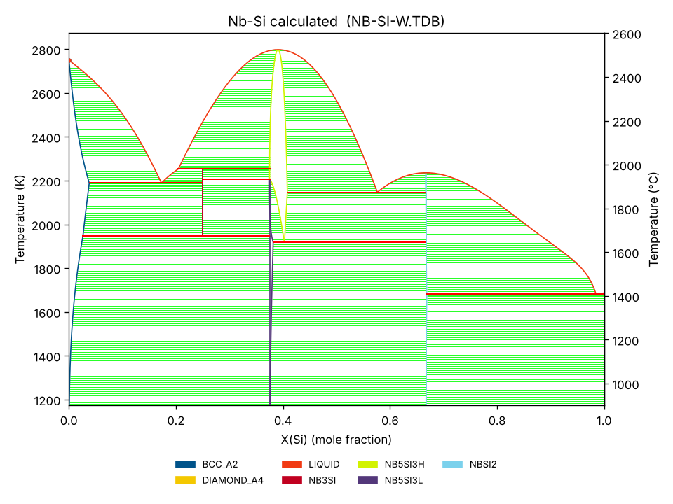
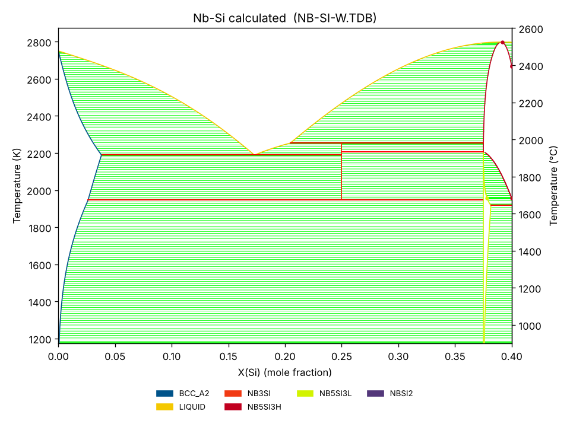

# TDB 후보 검증 보고서: `NB-SI-W.TDB`

## 출처 (사용자가 채움)

- 출처 논문: Li Y, Li C, Du Z, Guo C, "Thermodynamic optimization of the Nb–Si–W ternary system", Calphad 43 (2013) 112–123, doi:10.1016/j.calphad.2013.04.004
- 내려받은 곳: 논문 온라인 보충자료 mmc1.zip (TDBDB 색인 경유, ars.els-cdn.com)
- 이용 조건·인용 방법: 논문 보충자료(Elsevier). 사용 시 위 논문 인용. 재배포 조건은 원 논문 페이지에서 확인 필요

## 읽기 결과

- 읽기: 성공 (파라미터 66개)
- 파일 지문(sha256 앞 16자리): `92e9ebc162152934`
- 원소: NB, SI, W
- 상 개수: 8

### 상 목록

| 상 | 부격자 비율 | 구성 성분 |
|---|---|---|
| BCC_A2 | 1.0 : 3.0 | NB,SI,W : VA |
| DIAMOND_A4 | 1.0 | SI |
| LIQUID | 1.0 | NB,SI,W |
| NB3SI | 0.75 : 0.25 | NB,W : SI |
| NB5SI3H | 0.5 : 0.125 : 0.375 | NB,W : NB,SI,W : NB,SI,W |
| NB5SI3L | 0.625 : 0.375 | NB,SI,W : SI |
| NBSI2 | 0.333 : 0.667 | NB,SI,W : SI |
| SI2W | 0.667 : 0.333 | SI : NB,W |

## 계산 상태도

> 원 논문의 상태도와 비교해 주세요: 상 종류, 공정·포정 온도, 고용 한계, 녹는점.

## 승인

- [ ] 원 논문 상태도와 비교 완료
- 승인자: 
- 날짜: 
